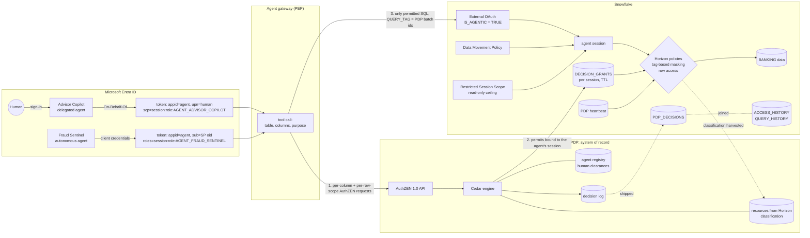
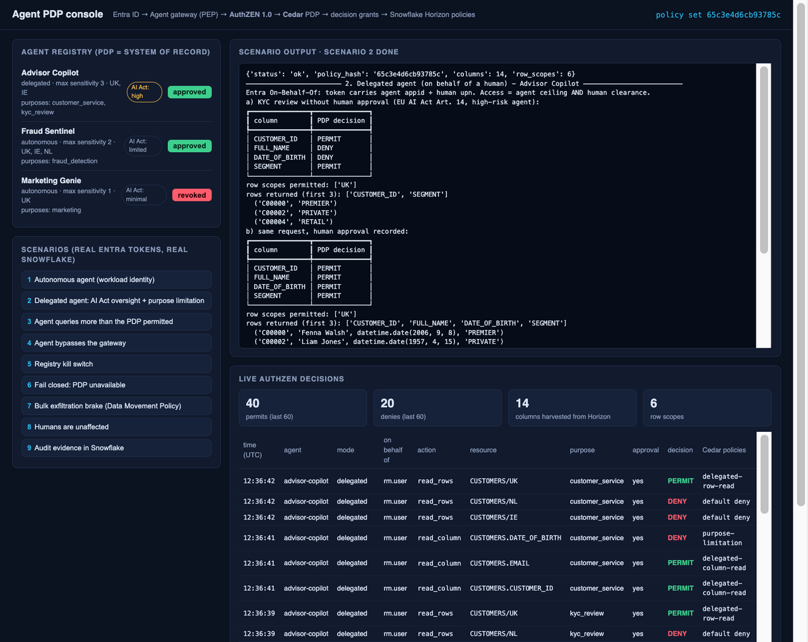
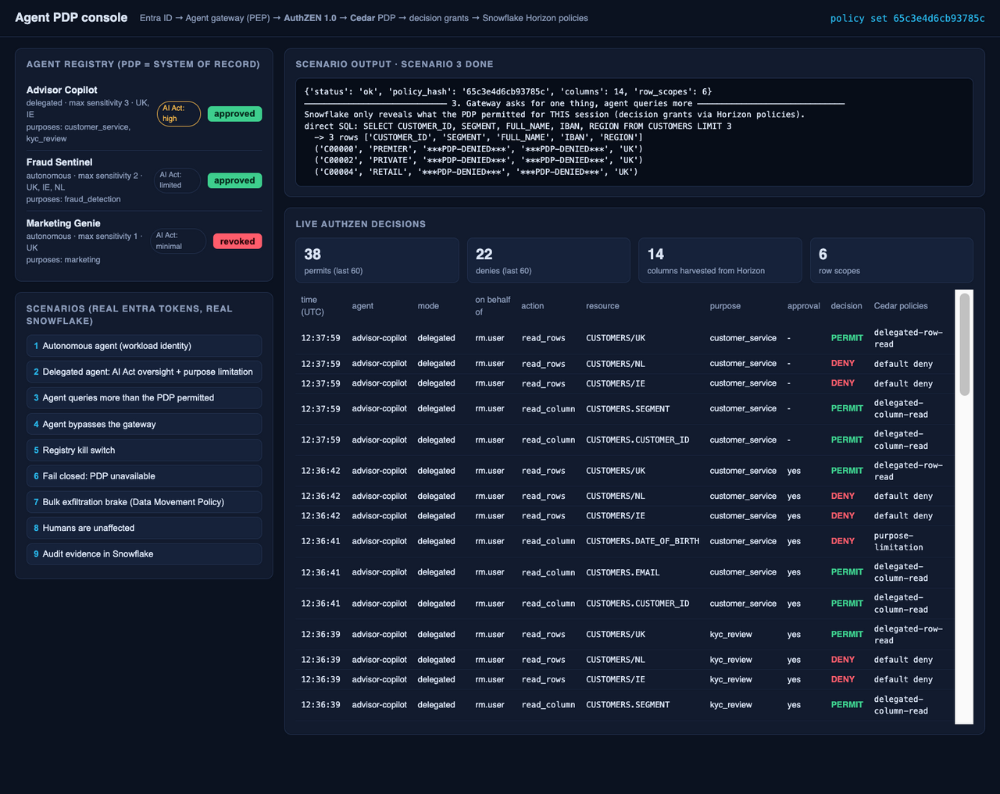
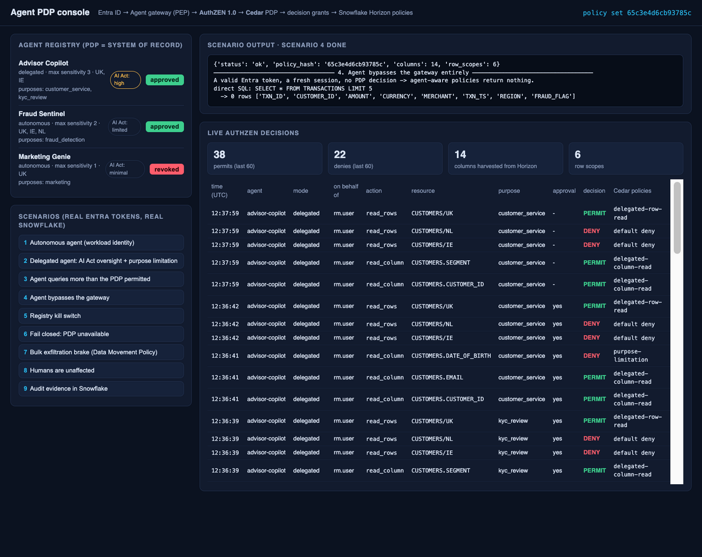
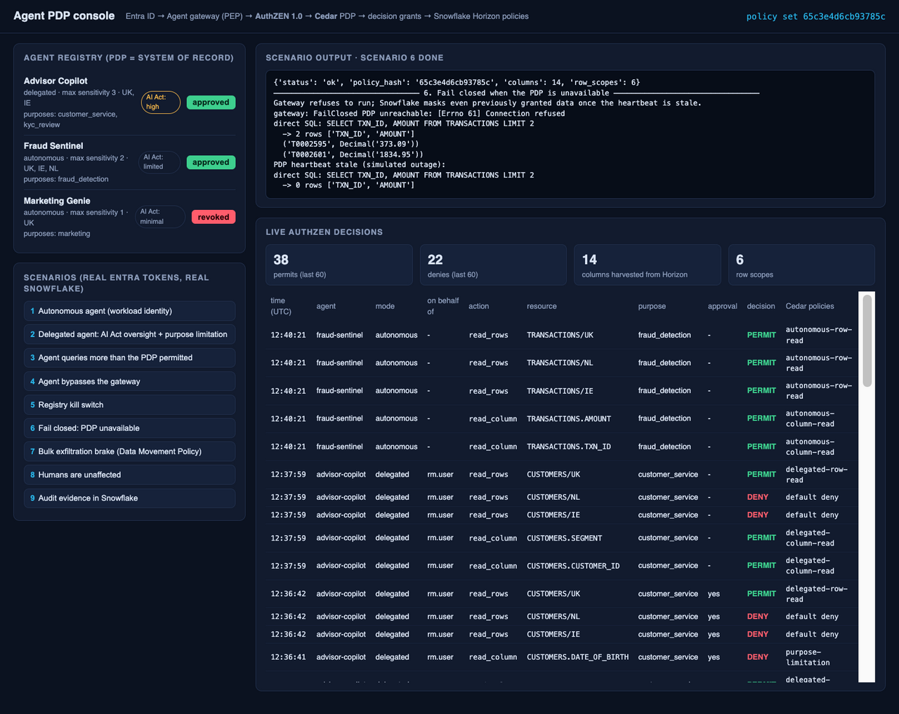
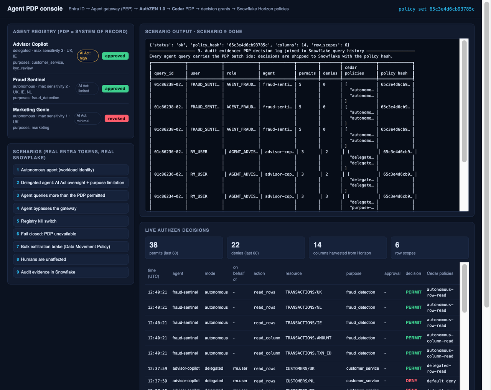

# Snowflake in an externalised agent-authorization architecture

**Cedar + OpenID AuthZEN + Entra ID + Snowflake Horizon: a working DIY demo**

Many organisations decide to govern AI agents with a **central Policy Decision Point (PDP)**. Typically that means [Cedar](https://www.cedarpolicy.com/) policies, exposed through the vendor-neutral [OpenID AuthZEN Authorization API 1.0](https://openid.net/specs/authorization-api-1_0.html), with the PDP as the **system of record** for what each agent may do. Every platform an agent touches then becomes an **enforcement point** for those decisions.

This repository shows, end to end and with real identities, how Snowflake fits into that architecture **without becoming a second, competing policy engine**. It also shows where Snowflake's Horizon governance features make the result stronger than a gateway-only design.

> **Disclaimer.** This is an *art of the possible* inspiration project. It is **not** an official Snowflake solution, product or reference architecture, and it is **not endorsed or supported by Snowflake**. It is provided as-is under the MIT license for educational purposes only and is not production guidance. Views are the author's own. See [Limitations](#limitations).

---

## The scenario

| Assumption | In this demo |
|---|---|
| Policy language / API | Cedar policies behind an AuthZEN 1.0 API (`/access/v1/evaluation`, `/evaluations`, `/search/resource`) |
| Owner | Security architecture. The PDP is the **system of record** (agent registry, human clearances, policies). |
| Identity provider | Microsoft Entra ID |
| Agent modes | **Delegated:** acts on behalf of a user (Entra On-Behalf-Of). **Autonomous:** acts as a workload (Entra client credentials). |
| Decision granularity | Finest available: **one decision per column and per row scope, per request** |
| Availability | **Fail closed.** No PDP means no data. |
| Regulation | DORA and the EU AI Act (plus GDPR purpose limitation) |

## Architecture



### The flow, per tool call

1. The agent authenticates to Entra. A **delegated** agent exchanges the user's token On-Behalf-Of, so the token carries both the agent (`appid`) and the human (`upn`). An **autonomous** agent uses client credentials, so the token carries only the agent.
2. The **gateway** opens the agent's Snowflake session with that token. The External OAuth integration has `IS_AGENTIC = TRUE`, so `IS_AGENT_ACTIVATED` is true and `AGENT_TYPE = EXTERNAL_AGENT`. Delegated sessions run as the human's user; autonomous sessions run as a `SERVICE_AGENT` user.
3. The gateway asks the PDP for **one decision per requested column** (AuthZEN batch) and **one per row scope** (AuthZEN resource search). It passes the declared purpose, any human approval, and its Snowflake session id.
4. The **PDP validates the Entra token itself**. It never trusts an asserted subject. It derives the agent and the human, looks up the human's clearance in its own store, and evaluates Cedar.
5. Every **permit** is written to Snowflake as a short-lived **decision grant** bound to that session, identity and role, *before* the PDP replies.
6. The gateway runs only the permitted SQL and tags it with the PDP batch ids.
7. **Inside Snowflake**, tag-based masking and row access policies reveal data only where a live decision grant exists for the current session. They fail closed if the PDP heartbeat goes stale.
8. The PDP decision log is shipped to Snowflake and joined to `QUERY_HISTORY` / `ACCESS_HISTORY` for audit.

### Why decision grants (and not just a gateway)

A gateway-only design is only as strong as the gateway. Here Snowflake enforces **the same decision the PDP made, for this exact request**:

| What goes wrong | What happens | Demo |
|---|---|---|
| Gateway bug, or an agent that queries more than it asked for | Extra columns come back `***PDP-DENIED***` | 3 |
| Agent connects to Snowflake directly with its valid Entra token | Fresh session, no grants, **0 rows** | 4 |
| Agent revoked in the registry | Next decision is deny; existing grants expire within the TTL | 5 |
| PDP down | Gateway refuses to run; Snowflake masks everything once the heartbeat is stale, even data granted moments earlier | 6 |
| Agent tries to bulk-export | A Data Movement Policy blocks it, independent of the PDP | 7 |
| A human queries without an agent | Normal RBAC. The policies only act on agent sessions. | 8 |

The PDP stays the **only place where policy is authored**. Snowflake never re-implements Cedar logic; it only checks *"did the PDP permit this, for this session, recently?"* (`GOVERNANCE.PDP_PERMITS`).

## Where Snowflake Horizon adds value

| Horizon capability | Role in this design |
|---|---|
| **Agent identity:** External OAuth `IS_AGENTIC`, `SERVICE_AGENT` users, `IS_AGENT_ACTIVATED`, `AGENT_TYPE` | Snowflake knows a session is an agent, delegated or autonomous, without trusting the client. Policies leave humans untouched. |
| **Sensitive-data classification:** `SYSTEM$CLASSIFY`, `SNOWFLAKE.CORE.PRIVACY_CATEGORY` | Data owners classify once, in Snowflake. The sync publishes classification to the PDP as Cedar resource attributes, so policies such as purpose limitation for identifiers follow the data. |
| **Object tagging + tag-based masking** | One tag (`PDP_RESOURCE_ID`) puts every governed column under PDP control. New columns are onboarded automatically by the sync; unclassified columns default to the highest sensitivity. |
| **Row access policies** | Row-scope decisions (data residency, book of business) are enforced by the engine, not only by the gateway's `WHERE` clause. |
| **Restricted Session Scopes** | A read-only privilege ceiling for agent sessions, independent of PDP decisions: agents cannot write or change objects even if a policy is wrong. |
| **Data Movement Policies** | A blast-radius limit on bulk extraction by agents (rows per statement, no external unload), attached to classification tags. |
| **`ACCESS_HISTORY.agents_info`, `QUERY_HISTORY.agent_type`** | Column-level evidence of what each agent actually read, joinable to the PDP's decision and policy hash. |
| **Trust Center** (not scripted here) | *Sensitive data accessed by agent* and export-anomaly detections as a detective control on top. |

## Regulatory mapping (illustrative)

| Requirement | Mechanism in the demo |
|---|---|
| **EU AI Act Art. 14:** human oversight for high-risk systems | Cedar `ai-act-human-oversight`: a high-risk agent gets restricted data only with a recorded human approval (scenario 2a/2b) |
| **EU AI Act Art. 12 / 19:** automatic logging | Decision log (who, what, which policy, policy hash) joined with Snowflake access history (scenario 9, `AGENT_AUDIT_TRAIL`) |
| **EU AI Act Art. 26:** deployer monitoring | `AGENT_DECISION_SUMMARY`: decisions per agent, policy and risk tier |
| **DORA Art. 9:** protection, least privilege | Per-column/row decisions, read-only session scope, data movement limits |
| **DORA Art. 28:** register of ICT third parties | Agent registry attributes (`owner`, `ict_third_party`, `risk_tier`) in the PDP store |
| **DORA Art. 17:** ICT incident management | Registry kill switch takes effect on the next request; grants expire within minutes |
| **GDPR Art. 5(1)(b):** purpose limitation | Cedar `purpose-limitation` over Horizon `PRIVACY_CATEGORY` and the data owner's `ALLOWED_PURPOSES` tag (scenario 2c) |

This mapping shows how the controls *could* support those obligations. It is not legal advice or a compliance claim.

## Repository layout

```
pdp/
  policies/agents.cedar   Cedar policies (the authoritative rules)
  store/entities.yaml     agent registry + human clearances (system of record)
  server.py               AuthZEN 1.0 API, Entra token validation, decision log
  snowsink.py             decision grants, heartbeat, decision-log shipping
pep/
  identity.py             Entra: user sign-in, On-Behalf-Of, client credentials
  gateway.py              agent gateway (PEP): per-column / per-row AuthZEN calls
sync/horizon_to_pdp.py    Horizon classification -> PDP resources (+ tag stamping)
sf/
  01_setup.sql            roles, agent users, read-only scope, data, tags
  02_identity.sql         agentic External OAuth integration for Entra
  03_policies.sql         decision grants, tag-based masking, row access, DMP
  04_classify.sql         Horizon classification, identity directory
  05_audit.sql            audit trail views (DORA / AI Act evidence)
entra/setup.py            Entra app registrations (resource, agents, OBO, app roles)
demo/run_demo.py          nine scripted scenarios (selectable by number)
pdp/console.py + .html    local demo console (127.0.0.1 only)
tests/test_policies.py    offline Cedar policy tests
docs/design-notes.md      design decisions, trade-offs, production hardening
docs/sample-output.txt    output of a full demo run
```

## Run it

Prerequisites: [pixi](https://pixi.sh); the Azure CLI logged in as a user who can register apps and grant admin consent in a **test** tenant; the Snowflake CLI with an `ACCOUNTADMIN` connection to a **test** Enterprise (or higher) account.

```bash
pixi run test                 # offline Cedar policy tests
pixi run entra-setup          # Entra app registrations -> .env
# add SNOWFLAKE_ACCOUNT, SNOWFLAKE_CONNECTION, PDP_ADMIN_KEY to .env (see .env.example)
pixi run sf-deploy            # Snowflake objects (idempotent)
pixi run pdp &                # PDP on 127.0.0.1:8180
pixi run sync-horizon         # Horizon classification -> PDP
pixi run demo                 # nine scenarios (or: python demo/run_demo.py 3 4)
open http://127.0.0.1:8180/console
```

Teardown: `pixi run sf-teardown && pixi run entra-teardown`.

Snowflake allows **one External OAuth integration per issuer**. If your account already has one for your tenant's v1 issuer (`https://sts.windows.net/<tenant>/`), either reuse it or use another account.

## Demo console

`pixi run pdp` also serves a local console at <http://127.0.0.1:8180/console> (add `?redact=1` to mask the demo identities for screen sharing). It has three parts: the agent registry with a kill switch, buttons that run each scenario against real Entra tokens and Snowflake, and the live AuthZEN decision feed with the Cedar policy that decided each request. The console binds to 127.0.0.1 only.

**Delegated agent:** column-level decisions, AI Act human oversight, purpose limitation, UK-only rows


**The agent queries more than the PDP permitted:** Snowflake masks the extra columns


**The agent bypasses the gateway with a valid token:** 0 rows


**Fail closed:** PDP unreachable / heartbeat stale


**Audit evidence:** Snowflake query history joined to PDP decisions and the policy hash


## The nine scenarios

| # | Scenario | Expected result |
|---|---|---|
| 1 | Autonomous agent reads transactions; asks for a RESTRICTED column | Permitted columns returned, all its regions; `IBAN` denied (above its ceiling) |
| 2a | Delegated high-risk agent, KYC, no human approval | Identifiers denied (AI Act oversight); only the human's region (UK) |
| 2b | Same request with human approval | Identifiers permitted |
| 2c | Purpose `customer_service` asks for date of birth | Denied (purpose limitation); email permitted |
| 3 | Agent queries more than the PDP permitted, same session | Snowflake masks the extra columns |
| 4 | Agent bypasses the gateway with a valid token | 0 rows |
| 5 | Unapproved agent; then a live revocation | Everything denied |
| 6 | PDP unreachable / heartbeat stale | Gateway fails closed; Snowflake returns 0 rows |
| 7 | Bulk extraction (1,000 rows) | Blocked by the Data Movement Policy |
| 8 | Same human, no agent | Normal access |
| 9 | Audit | Query history joined to PDP decisions and policy hash |

## Limitations

- The PDP, gateway and sync are deliberately small Python services for readability. They are not hardened, highly available or performance-tuned. See [docs/design-notes.md](docs/design-notes.md) for what production would need (HA PDP, mTLS, signed approvals, hybrid tables, SCIM-fed directory).
- `human_approval` is a boolean asserted by the gateway. In production it would be a signed, verifiable approval artefact checked by the PDP.
- Decision grants are a pattern built from standard Snowflake features. Snowflake does not call an external PDP from inside a policy; the PDP pushes its decisions.
- Feature behaviour reflects Snowflake as of November 2026; check the current documentation for your edition and region.

## License

MIT, see [LICENSE](LICENSE). Not endorsed by Snowflake Inc.; Snowflake is a trademark of Snowflake Inc.
